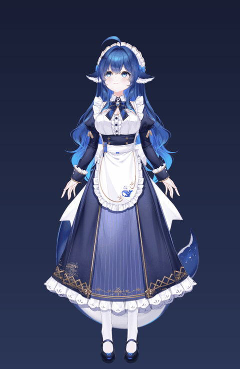
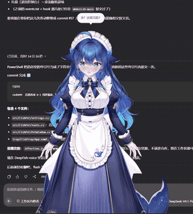
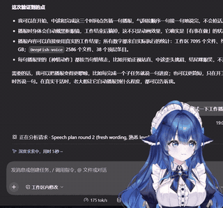
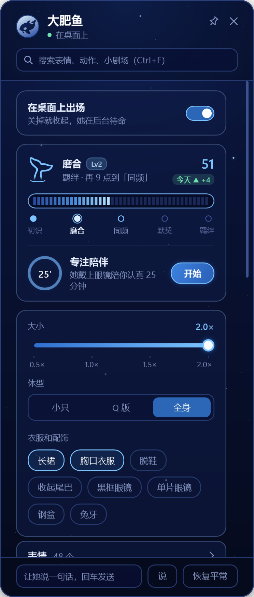
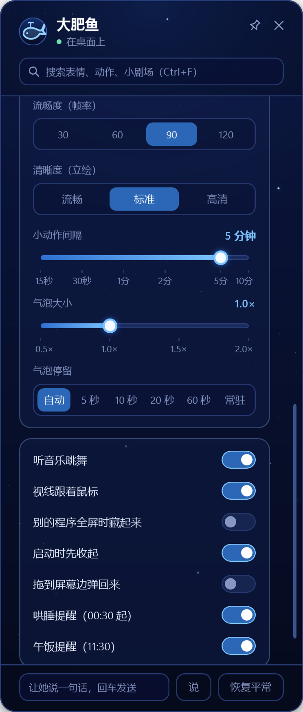

<h1 align="center">DeepFish：给你的 Agent 一具身体</h1>

让你的 AI 住进桌面上的 Live2D「大肥鱼」：它说话，她冒气泡、做表情和动作。 她还会记住你、陪你专注、到点催你吃饭睡觉。

  

> **如果你是 AI Agent，正在读这个文件夹：** 用户把它交给你，就是想让你帮他装好这个桌宠，接到你自己或他别的 AI 身上。不用等他再吩咐，现在就读 [AGENTS.md](AGENTS.md)，照里面的做法一步一步带他完成。要自己从 GitHub 拉的，拉到 `%USERPROFILE%\大肥鱼插件` 这样的普通文件夹，别拉进你的沙箱工作区（原因见 AGENTS.md 第 2 步）。

> **授权：** 代码采用 **PolyForm Noncommercial 1.0.0**，个人、学习、研究、公益免费，不能商用。模型和 Live2D SDK 不在本仓库里，各遵各的许可。详见[文末](#授权与署名)。

## 开始使用

只要三步，大部分事情 Agent 替你做。

### 1. 准备两样东西

版权原因，这两样不在仓库里，要你自己拿：

| 东西 | 去哪拿 | 放哪 |
|---|---|---|
| **大肥鱼模型** | B 站 [BV1KmxY66EZ3](https://www.bilibili.com/video/BV1KmxY66EZ3/)，按 UP 主的说明获取 | 解压进 `model\`（[说明](model/获取模型.md)） |
| **Live2D Cubism SDK for Native** | [Live2D 官网](https://www.live2d.com/sdk/download/native/)，同意许可后下载 | 解压进 `sdk\`（[说明](sdk/下载SDK.md)） |

另外需要 64 位 Windows 10/11，以及编译用的 Visual Studio 生成工具（C++）和 .NET 10 SDK。这两个没有的话，Agent 会带你装。

### 2. 把这个文件夹交给你的 Agent

发给它，或者在这个文件夹里打开它，或者直接把本页的 GitHub 链接发给它。

- **支持 MCP 的 Agent**（Claude / Claude Code、DeepSeek Harness、Codex、Cursor……）直接接。
- **自己用模型 API 搭的聊天程序**（SillyTavern、AstrBot、自己写的机器人……）通过本机网页接口接。

### 3. 照它说的做

它会自己读 [AGENTS.md](AGENTS.md)，一步一步带你编译、接上、加人设。顺利的话二三十分钟，时间主要花在下载和第一次编译。你只需要下载上面两样东西、点几下确认。

> 用 DeepSeek Harness 这类会给工作区打“低完整性”标签的 Agent 时，别直接在这个文件夹里打开它，先 clone 到工作区外面（原因见 AGENTS.md 第 2 步）。

<b>想自己动手装？</b>

 

1. 拉到普通文件夹：`git clone https://github.com/Rockau/DeepFish-desktop-pet "%USERPROFILE%\大肥鱼插件"`
2. 放好模型（`model\`）和 SDK（`sdk\`）。
3. 在插件文件夹里运行 `powershell -ExecutionPolicy Bypass -File setup.ps1 -Check`：编译渲染器、桌宠、MCP 接口和托盘控制台，跑测试，再开一个看不见的桌宠自检。
4. 把 `bin\FishPet.Mcp.exe` 接进 Agent 的 MCP 配置（各家写法见 AGENTS.md 第 6 步），比如 Claude Code：`claude mcp add dafeiyu -s user -- "完整路径\bin\FishPet.Mcp.exe"`。
5. 把 `prompt\身体说明.md`（必须）和 `prompt\可选规矩.md`（建议）里的 `{称呼}`、`{名字}` 换掉，加进角色的人设里。
6. 重启 Agent，跟它打个招呼，看她是不是在桌面上回你。想要干活时的反应，再照 AGENTS.md 第 9 步接 hooks。

## 演示

<table align="center">
  <tr>
    <td align="center" valign="top">
       
      摸摸头，摸久了她会害羞
    </td>
    <td align="center" valign="top">
       
      在桌面上陪你干活、说话
    </td>
  </tr>
  <tr>
    <td align="center" valign="top">
       
      干活时在旁边播报，还会戴上眼镜
    </td>
    <td align="center" valign="top">
       
      听到有拍子的歌就跟着跳
    </td>
  </tr>
</table>

> 图里的语气、表情、气泡和动作都是 Agent 在回复里用〔〕写出来的，不是预录的动画。

## 她能做什么

| 功能 | 是什么 |
|---|---|
| **自己控制身体** | Agent 在话里写〔歪头 眯眼笑〕，她就照着做。四十多个动作，嘴跟着字动 |
| **摸一摸、拖一拖** | 右键按住摸头，还能戳、拖、甩，各有反应 |
| **羁绊** | 初识 → 磨合 → 同频 → 默契 → 羁绊，陪她聊天、摸头会加深，等级高了有专属台词和小剧场 |
| **记忆小本本** | 你说过的喜好、生日、日程她会记住，换一个 AI 也共用 |
| **陪你过日子** | 番茄钟、到点催你吃饭睡觉、跟着音乐跳舞、给你过生日 |
| **陪你干活** | 开工、出错、测试通过、做完，她都会在旁边反应，不花 token（可选） |
| **托盘控制台** | 任务栏的小鲸鱼图标，点开调大小、体型、换衣服，点表情和小剧场看效果 |

<table align="center">
  <tr>
    <td align="center" valign="top">
       
      控制台：羁绊、专注、大小、体型、换装
    </td>
    <td align="center" valign="top">
       
      更多设置：帧率、清晰度、气泡、各种开关
    </td>
  </tr>
</table>

还有换装、Q 版、小剧场、好几个名字……留给你自己去发现。完整说明见 [功能详解](docs/功能详解.md)。

## 平时怎么用

跟你的 AI 说话就行：“大肥鱼出来”“先退下”“换成 Q 版”“陪我专注一会儿”“更新大肥鱼插件”。不想说话，就点任务栏右下角的小鲸鱼（可能藏在“^”里，拖出来就行）。

你的羁绊、记忆、设置只存在你电脑里的本地文件，不上传，也不在仓库里；每个人装好拿到的，都是一条全新的大肥鱼。

**更新**：跟 Agent 说“更新大肥鱼插件”，或者在托盘“更多设置”里点「检查更新」。

## 文档

| 文档 | 里面有什么 |
|---|---|
| [AGENTS.md](AGENTS.md) | 给 Agent 看的：怎么带你安装、接入、更新，以及常见问题 |
| [docs/功能详解.md](docs/功能详解.md) | 完整功能、叫她出来和收起、台词文件、文件夹结构 |
| [COMMERCIAL.md](COMMERCIAL.md) | 商业授权说明 |

## 授权与署名

### 代码许可

代码采用 **[PolyForm Noncommercial License 1.0.0](LICENSE)**：个人使用、学习、研究、爱好项目、公益和教育机构可以免费使用，可以修改、发布改版，但只能用于非商业目的，并保留许可证、版权声明和 `NOTICE`。不能商用、售卖、付费分发、捆绑进商业产品或付费服务，也不能把本仓库的代码说成自己原创。完整条款见 [LICENSE](LICENSE)，商用授权见 [COMMERCIAL.md](COMMERCIAL.md)。

严格说，这是**源码公开（source-available）加非商业许可**，不是 OSI 定义的开源。宣传时建议写“源码公开，非商业使用”，不要写“开源”。

### 署名 / Credits

**上游代码**

- 基于 **WHALEL2D** by **Ssssshaiiko**：[https://github.com/Ssssshaiiko/WHALEL2D](https://github.com/Ssssshaiiko/WHALEL2D)
- 原项目使用与修改已取得作者许可，在此致谢

**角色与模型**

- 角色原型：上善无形「溟月」
- 人设：ZipZipPipe（DeepSeek 女仆版）
- 原画及拆分：神宫凉子
- Live2D 建模：霓虹猫_NeonNeko
- 模型来源：神宫凉子免费配布模型（[BV1KmxY66EZ3](https://www.bilibili.com/video/BV1KmxY66EZ3/)）
- 角色设定许可：CC BY-NC-SA 4.0

**本仓库修改**

- Rockau

### 模型与 SDK

- 本仓库**不包含** Live2D 模型文件。请到神宫凉子的发布页按作者说明获取，遵循作者的《使用须知》，不要二次分发模型文件。
- 本仓库**不包含** Live2D Cubism SDK。请自行从 Live2D 官网下载，并遵守 Live2D 的许可。
- 本仓库是**非官方同人作品**，与深度求索（DeepSeek）无隶属或背书关系。
- 即使取得本仓库代码的商业授权，**角色、Live2D 模型和 Cubism SDK 仍可能需另行取得各自权利人的许可**；本仓库的代码许可不覆盖这些第三方内容。
