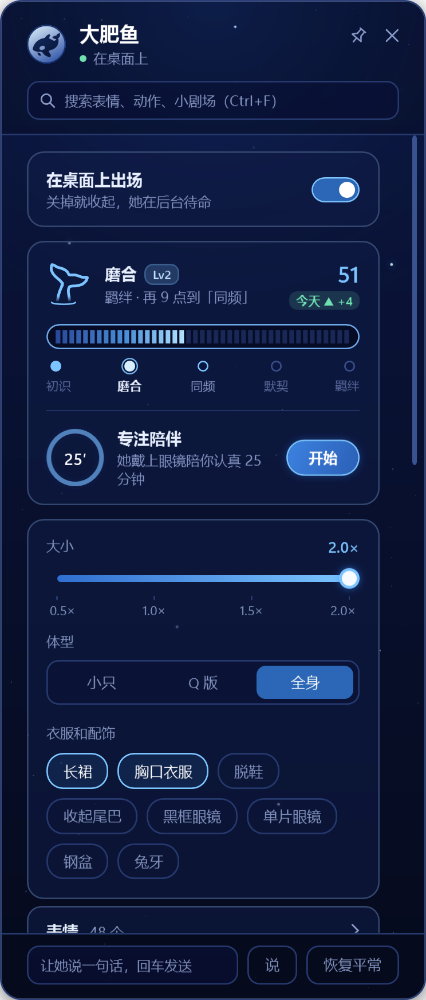
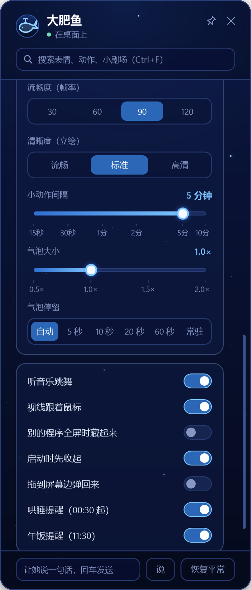

# 大肥鱼功能详解

这里是完整的功能说明，从 [README](../README.md) 里挪过来的，内容没有删。第一次用不用看，想知道“她还会什么”再翻。

## 她能做什么

### 身体

- **自己控制身体**：Agent 说话时在句子里写〔〕，比如 `〔歪头:右 眯眼笑〕嗯……让我想想〔竖手指〕`，她就照着做。四十多个动作，能调轻重、快慢、次数和左右。
- **跟着话走**：字按说话的节奏一个个出来，嘴跟着动；动作随后面那段话的长短伸缩。
- **被碰会有反应**：摸头、戳脸、点手、点裙子、点尾巴各有反应和台词，连点会掉钢盆。
- **右键摸头**：在她头上（头加整张脸）按住右键并移动，鼠标变成一只白色的小手，真的在摸她，不是播固定动画：
  - 头朝着和手相反的方向转，眼睛却看着手；手靠近头的右边她单闭右眼，靠近左边单闭左眼，摸到脸上两只眼都闭上，笑眼。
  - 摸得越久越害羞：3 秒后脸红，8 秒后眉毛和嘴也更害羞。
  - 松手后她会脸红一下，再按摸的时间分三档，台词和神情不同：摸得短会失落（“就摸这么一会吗……”），中等的舍不得手离开，摸得久就腻腻歪歪。
- **鼠标停在她身上**：停在同一个部位约 10 秒，她会做个小反应、说一句话，每次触发后冷却 30 秒。
- **拖起来有惯性**：左键拖她，会随着拖动的方向和快慢被甩，往下放被压扁、往上提被拉长，拖得越快摆得越厉害；转圈或甩得太狠会头晕，放下后晕一会儿，晕得越厉害越久。
- **视线跟着鼠标**：她在屏幕上看你的鼠标。鼠标停住不动，眼睛先回正，头再慢慢转回来。
- **闲着的时候**：自言自语、按时段和节日说不同的话、整点报时、演小剧场（跳舞、偷吃、打瞌睡……）。
- **照镜子**：Agent 能看到她现在的样子，也能先试一个表情看效果；说过的话会自动拍下来，半小时内能回头看。
- **穿戴和体型**：长裙、胸口衣服、脱鞋、收起尾巴，黑框眼镜、单片眼镜、钢盆、兔牙；小只、Q 版、全身三种体型。

### 她的小日子

- **第一次出场的欢迎**：全新安装后她第一次露面，会自己说几句：托盘小鲸鱼在哪、怎么让她先收起来、数据只在本机。内置、不花 token、只说一次，台词在 `welcome.txt`。
- **托盘控制台**：任务栏右下角有个小鲸鱼图标，点开就是控制面板：出场/收起、大小、体型、穿戴、帧率、气泡，还能直接点表情、动作、小剧场看效果，不用跟 Agent 说话、不花 token。
- **羁绊**：初识 → 磨合 → 同频 → 默契 → 羁绊，五级。陪她聊天、摸摸头会涨，戳裙子、连打会扣，很久不来会想你。早上第一次见面会按你昨晚睡得早晚夸你或念叨你。等级高了会解锁专属台词和彩蛋小剧场。托盘里能看到。
- **记忆小本本**：你随口说过的喜好、生日、日程，她会记下来，下次聊到自然接上（“你本来就爱喝冰美式嘛”）。接着她的 Claude 和 DeepSeek Harness 用的是**同一本**，换哪边都记得。只在需要时查几条，记再多也不拖慢干活。
- **到点叫你**：按你电脑的时间——
  - 每晚 00:30 起四层“迫真哄睡”：温柔关心 → 严肃 → 生气“时间到了” → 00:47 黑脸逐字质问。
  - 每天 11:30 午饭提醒。
  - 默认两个都是关着的，在托盘“更多设置”里能打开；台词在 `alarms.txt`，想改随便改。
  - 到点时她要是在桌面上，会先鞠躬退场，再在屏幕正中快速出场，然后才开口提醒；她要是收起待命着，就不提醒，不会自己跳出来。
- **番茄钟**：说一声“陪我专注一会儿”，她戴上眼镜安静陪你 25 分钟，到点响铃叫你休息。
- **工作反应**：接上 hooks 后，Agent 干活时她会在旁边反应——开工打招呼、等你批准时探头、编译失败冒冷汗、测试通过开心、长任务做完夸你；接着上次的会话、你中途按了中断、或者它闷头想了 30 秒还没动静，她也接一句。不经过模型，不花 token。
- **跟着音乐跳舞**：电脑里在放有拍子的歌，她就跟着拍子跳（身子左右转、头跟着甩，就是她自己的那一支舞）。跳着的时候偶尔会换表情：开跳约 30 秒来一个，演 15 秒收回，再等约 30 秒来下一个——眯眼笑＋微笑、眯眼笑＋大笑、闭眼＋挑眉，一轮三个不重样、顺序随机。BPM 越高跳得越快，BPM 越低越慢。她说话、被摸、被拖的时候自动让位，歌一停就回到原样。用系统自己的 loopback 听声，不录音、不上传；`settings.json` 里 `"MusicDance": false` 可以关掉。
- **生日**：告诉她你的生日，那天她会给你过生日。
- **多个名字**：大肥鱼、鲸鲸、哦鲸鲸、蓝色大肥鱼、吃大白饭的……喊哪个她都知道是在叫她（要把 `prompt\可选规矩.md` 加进人设）。

**你的数据只在你自己电脑上**：羁绊、记忆、设置都存在插件文件夹里的本地文件，不上传；这些文件也不在仓库里，每个人装好拿到的都是一条全新的大肥鱼。

## 平时怎么用

跟你的 AI 说话就行，比如：

| 你说 | 她会 |
|---|---|
| 大肥鱼出来 / 鲸鲸 / 出来一下 | 出场打招呼 |
| 先退下吧 | 鞠躬淡出，在后台待命 |
| 换成 Q 版，大小调到 0.8 | 改体型和大小，下次打开也记得 |
| 戴上眼镜，把尾巴收起来 | 换穿戴 |
| 我爱喝冰美式 / 我生日是 XX 月 XX 日 | 记进小本本 |
| 陪我专注一会儿 | 开 25 分钟番茄钟 |
| 关掉午饭提醒 | 关掉（托盘“更多设置”里也能点） |
| 跳个舞 | 演跳舞小剧场 |
| 更新大肥鱼插件 | 查新版本、更新、重新编译 |

不想说话的时候，点任务栏右下角的小鲸鱼图标，在面板里点。

## 托盘控制台

她出场时，任务栏右下角会有一个小鲸鱼图标（第一次出现可能藏在“显示隐藏的图标”里，把它拖出来就行）。左键点开就是控制台：

<table align="center">
  <tr>
    <td align="center" valign="top">
       
      出场开关、羁绊、专注陪伴、大小、体型、衣服配饰
    </td>
    <td align="center" valign="top">
       
      “更多设置”：帧率、清晰度、气泡、哄睡、午饭提醒
    </td>
  </tr>
</table>

- 面板里能直接：出场/收起、调大小和体型、换衣服配饰、点表情/动作/小剧场看效果、看羁绊、开番茄钟；这些都不经过模型、不花 token。
- 右键小鲸鱼：出场/收起、打开面板、退出控制台（连桌宠一起退）。

## 叫她出来、收起和退出

- **出来**：装好、Agent 连上 MCP 后，她一般会自己出现。如果开了“启动时先收起”，叫她一声就行——“大肥鱼出来”“鲸鲸”“出来一下”。
- **收起**：跟她说“先退下”“回去待命”，她会鞠躬淡出；或者关掉托盘里的“在桌面上出场”开关，或右键小鲸鱼选“收起”。收起后程序还开着，叫一声就回来。
- **完全退出 Agent**：Agent 正常退出，她几秒内就跟着鞠躬退场；被关掉、断开的话大约 5 秒后也退（留一点时间给它重启重连）。任务栏的小鲸鱼也会跟着消失。想马上收掉：右键小鲸鱼选“退出控制台”。
- **再回来**：下次启动 Agent、连上 MCP，她会自动出来；也可以直接运行 `bin\FishPet.exe`。

## 分享给别人

只分享插件本身：`sdk\`、`model\`、`renderer\build\`、`bin\`、`cache\`、`check\` 都不要带；自己机器上的 `settings.json`、`api.json`、`affection.json`、`memory*.json`、`errors.log`、`tray\ui.json`、`tray\tray.log` 也先删掉——不然别人装好拿到的会是你的设置、记忆和 API key，而不是默认设置。

## 关注和更新

**查更新**：托盘“更多设置”最底下有一个「检查更新」按钮，点一下立刻去 GitHub 看一眼（只读公开的版本记录，不上传任何东西），结果显示在按钮下面——已是最新、落后几个提交（带最新一条改动）、或者查不了（不是 git 拉下来的副本 / 网络不通）。有新版本的话，Agent 也会在你的对话里告诉你改了什么、问你要不要更新。用 git 拉下来的才查得到（让 Agent 带你装的就是）。

**怎么更新**：跟 Agent 说“更新大肥鱼插件”，它会照 AGENTS.md 最后“更新插件”那一节做：拉新代码、重新编译、自检，身体说明有改动就帮你换人设里那段。你的羁绊、记忆、设置不受影响。

## 文件夹里有什么

| 位置 | 是什么 |
|---|---|
| `LICENSE` | PolyForm Noncommercial 1.0.0 许可证全文 |
| `NOTICE` | 上游代码、角色与模型的署名和第三方说明 |
| `COMMERCIAL.md` | 商业授权说明与联系方式 |
| `AGENTS.md` | 给 Agent 看的：怎么带用户安装、接入，平时怎么用，怎么更新 |
| `prompt\身体说明.md` | 给角色看的身体说明（必须加进人设） |
| `prompt\可选规矩.md` | 出场与收起、称呼、记忆这几段可选规矩 |
| `setup.ps1` | 检查、编译、自检 |
| `renderer\` | Live2D 渲染器源码（C++，用你自己下载的 SDK 编译） |
| `audio\` | 她的耳朵：WASAPI loopback 抓系统正在播的声音，给“跟着音乐跳”用；不录音、不上传 |
| `src\FishPet\` | 桌宠程序（带本机网页接口）；`src\FishPet.Mcp\` MCP 接口；`src\FishPet.Tests\` 测试 |
| `tray\FishTray\` | 托盘控制台源码（setup.ps1 编到 `tray\app\`） |
| `hooks\claude\` | Claude Code 的工作反应 hook |
| `hooks\dsh\` | DeepSeek Harness 的插件包：MCP 接入（dafeiyu-mcp）和工作反应（dafeiyu-hooks） |
| `mutter.txt` `skits.txt` `touch.txt` `events.txt` `alarms.txt` | 她的台词：自言自语、小剧场、被碰的反应、工作反应、到点提醒 |
| `stroke.txt` `hover.txt` `dizzy.txt` | 右键摸头松手后的三档台词、鼠标停在她身上时的台词、拖晕后的台词（格式和 `touch.txt` 一样）。台词文件改了不用重新编译，重启桌宠生效 |
| `sdk\`、`model\` | 放你自己下载的 SDK 和模型 |

运行后会生成这些（只在你电脑上，不进仓库）：`settings.json` 设置、`affection.json` 羁绊、`memory.json` / `memory-archive.json` 记忆、`api.json` 本机接口的地址和口令（别给别人）、`errors.log`。
